## 1. What RAG Is

Retrieval-Augmented Generation (RAG) is an architectural pattern that connects a language model to an external knowledge source at answer time. Instead of relying only on information encoded in model parameters, the application retrieves relevant content and supplies it as context for the model to use.

This is particularly useful when information changes frequently, is private to an organisation, or must be traceable to approved source material.

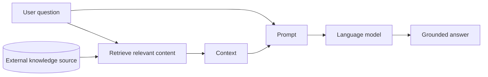

Best suited when information:

- Changes frequently
- Is private to an organisation
- Must be traceable to approved source material

---

## 2. Why RAG: Separation of Responsibilities

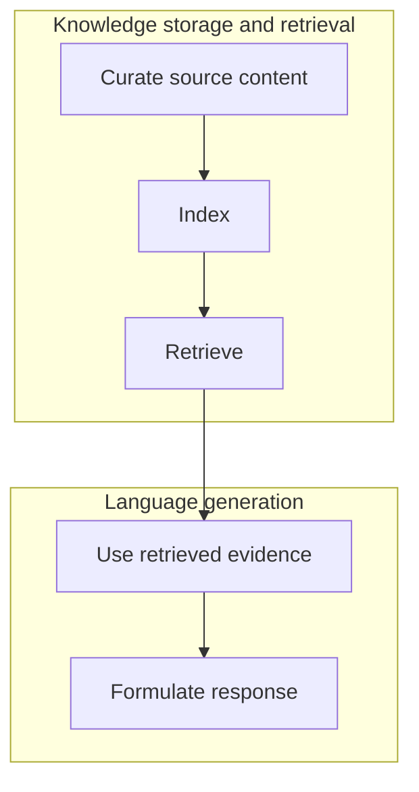

| Concern | Position in the article |
| --- | --- |
| Fine-tuning | Not usually the right mechanism for keeping frequently changing facts current |
| Correctness | RAG improves grounding but does not guarantee correctness |
| Quality drivers | Retrieval quality, source quality, prompt design, evaluation |

---

## 3. High-Level Architecture: Two Flows

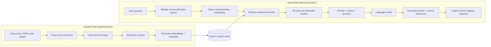

| Flow | Trigger | Characteristic |
| --- | --- | --- |
| Ingestion | Content added or updated | Asynchronous |
| Query | Each user request | Latency-sensitive |

---

## 4. Query Flow as a Sequence

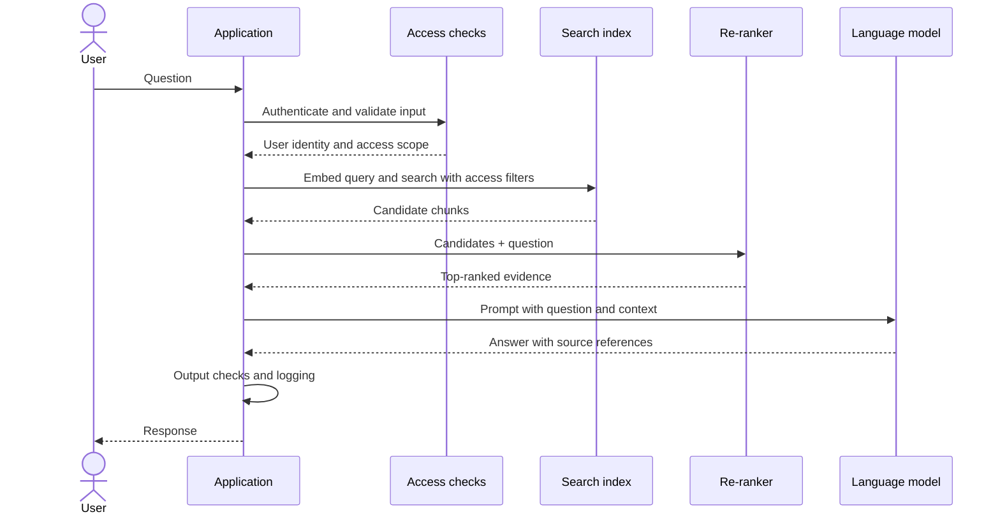

---

## 5. Core Building Blocks

### 5.1 Ingestion

Extraction should preserve:

- Headings
- Tables
- Document identifiers
- Effective dates

### 5.2 Chunking and Metadata

Chunk size and overlap are design parameters, not universal constants.

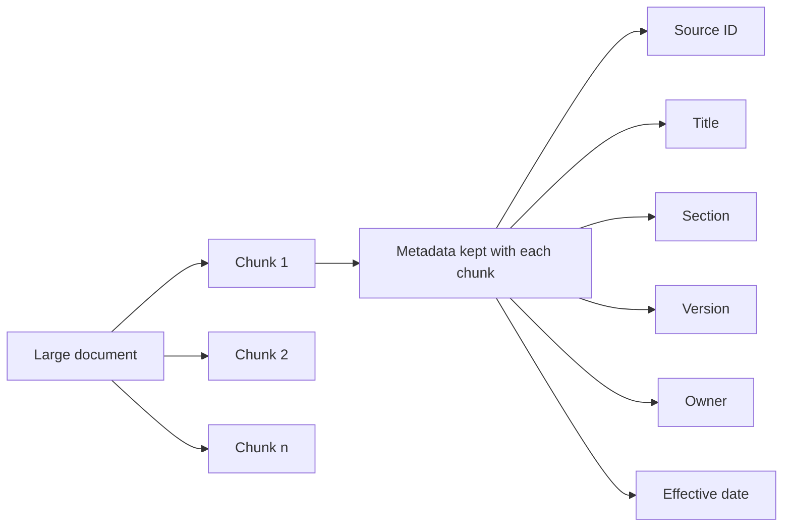

Recommended starting experiment: compare multiple chunk sizes and evaluate retrieval quality against a representative question set.

### 5.3 Embeddings and Indexing

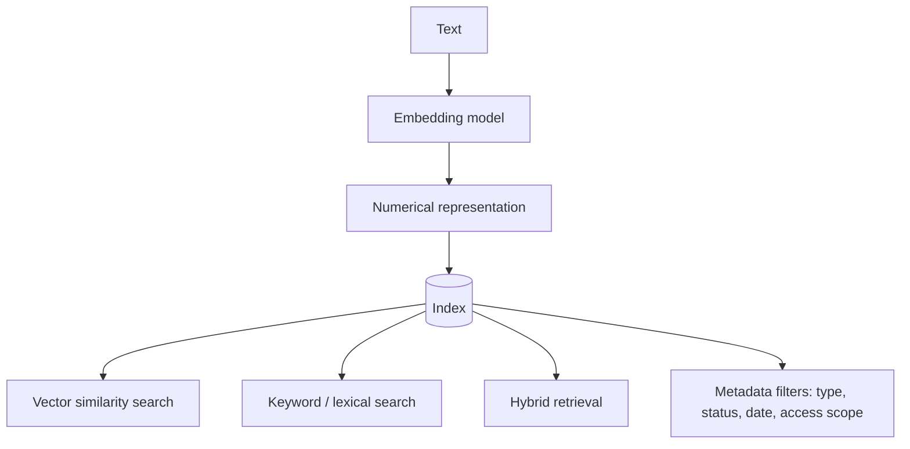

### 5.4 Retrieval and Re-ranking

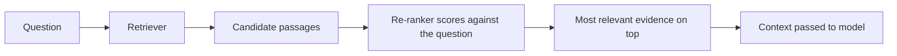

More passages are not always better: excess context increases cost, latency and distraction.

### 5.5 Generation

The prompt must:

1. Separate the user question from retrieved evidence
2. Instruct the model to ground its response in supplied context
3. Instruct the model to acknowledge missing evidence
4. Request source references where possible

---

## 6. Design Decisions

| Decision | Questions to evaluate |
| --- | --- |
| Chunking | Fixed size, semantic or structure-aware? |
| Retrieval | Vector, keyword or hybrid? |
| Re-ranking | Is the extra latency justified? |
| Metadata | Which filters are required? |
| Model | Which model meets quality, latency and cost needs? |
| Context | How much evidence should be passed to the model? |
| Citations | How will each answer trace to its source? |
| Refresh | How are changed and deleted documents handled? |

There is no single best configuration. Evaluate with realistic questions and representative documents.

---

## 7. Enterprise Considerations

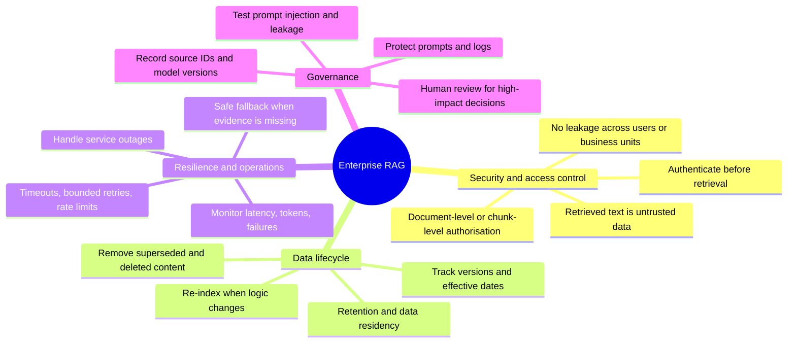

### Security Enforcement Point

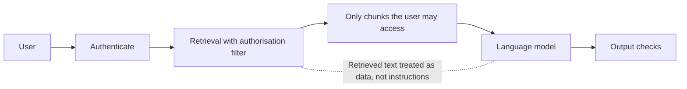

---

## 8. Evaluation

Evaluate retrieval and generation separately.

| Layer | Example measures |
| --- | --- |
| Retrieval | Recall@k, precision@k, ranking quality |
| Grounding | Faithfulness to retrieved evidence |
| Answer quality | Relevance, completeness, correctness |
| Operations | Latency, availability, cost |
| Security | Access-control tests, leakage scenarios |

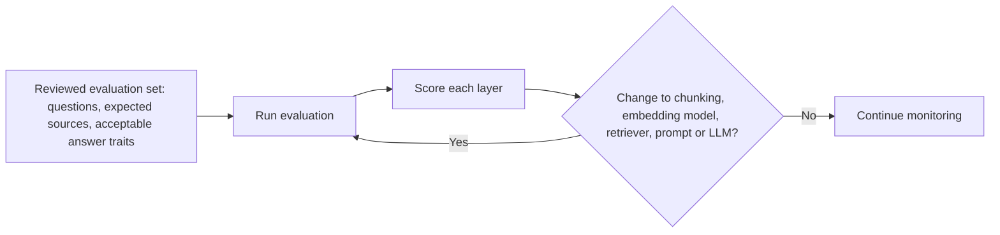

---

## 9. Key Takeaway

RAG is a system, not a database feature.

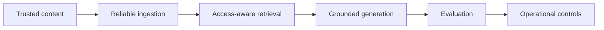

A vector index alone does not make an application enterprise-ready.

---

*Learning note: This article is an architectural introduction. Specific technology choices should be validated against the organisation's security, regulatory, data and operational requirements.*
